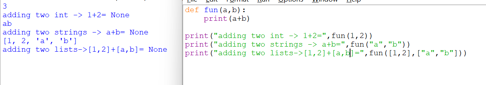
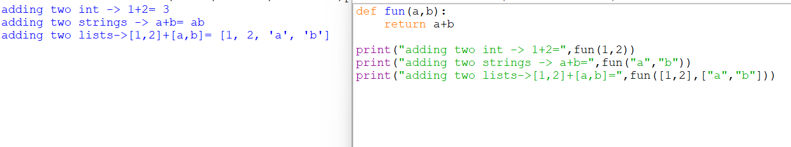

Pydantic

- It is a python library used for data type validation

**Need**

- As a backend developer I have to apply validations on backend so that even if any frontend or client sends faulty data, I can fail faster and do not proceed with processing
- Other languages have strict type checking but in case of python there are two differences

1. The dtype entered as type hint is optional and not strict
2. python accepts any dtype in the function parameter by design so that is also true in case for the api methods.

-Overall, in python strict type validation is required from backend side like: if the entered value for age is a number, it is within some range, etc; in case of email, entered value must contain @ and have some length checks and other constraints etc.

It causes three issues

- more emphasis on validation instead of business logic
- As validation has to be done manually more possibility of manual error
- more code to maintain

**Solution**

Pydantic library

- BaseModel -It is basically a struct/class/model that has all the type validation capabilities predefined within itself
- I can inherit this BaseModel in my DTO to use its functionalities
- Where it should be used - for APIs
- Where can I skip this - whenever I am internally entering the values/ it is a local dto tracked internally and is ensured to be correct each time -This can only happen if the data is not being accepted from external sources like clients/frontends.

- Field -It is just a tool that allows me to provide descriptions and constraints
- Using Field I can specify all the things/requirements needed for that particular field
- example:
  employee_name: str = Field(..., min_length=2, max_length=50, description="Full name of the employee", examples=["Rucha Kukreti"], strip_whitespace=True)
- ... -> for mandatory value
- John -> for default value

**Serialization Deserialization**

- Clients and servers can be written in very different technologies like JS(Client) and Rust(server) both deal with dtypes in different ways such that something accepted by JS might not be valid in case of Rust
- how clients and servers make sense of the data that is being sent and recieved
- All the communicating entities over the internet agree on some STANDARD to get rid of this issue. The standard is -Serialization and Deserialization
  -It is basically converting the to and fro data into some common format so that it becomes domain/language/environment independent.

-Types

1. Text based: JSON, YAML, XML, CSV, etc.
2. Binary format: Protobuf, etc.
